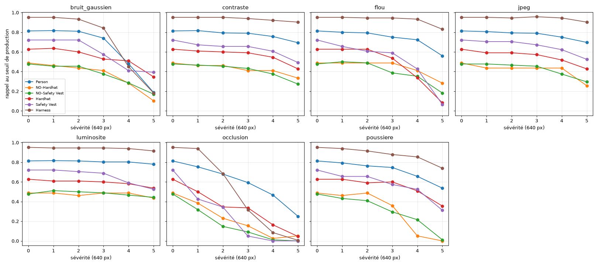
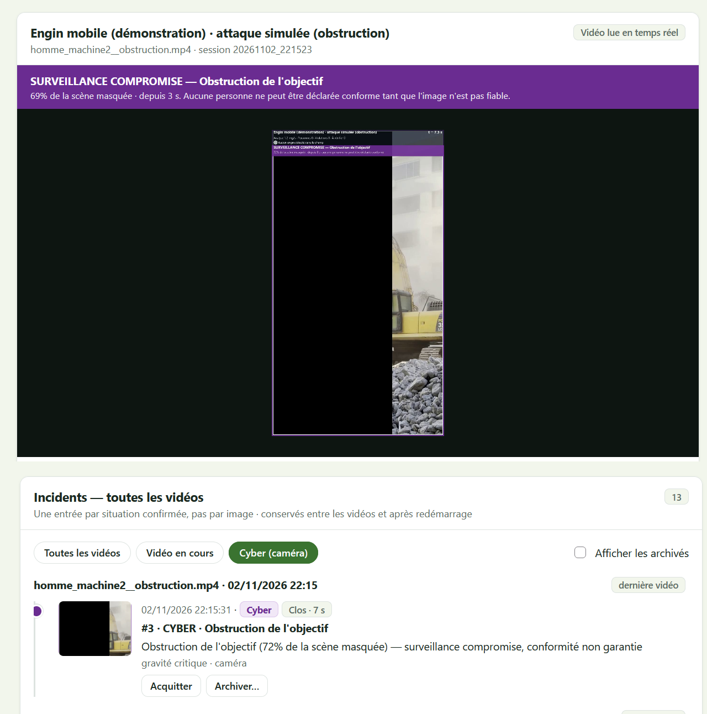
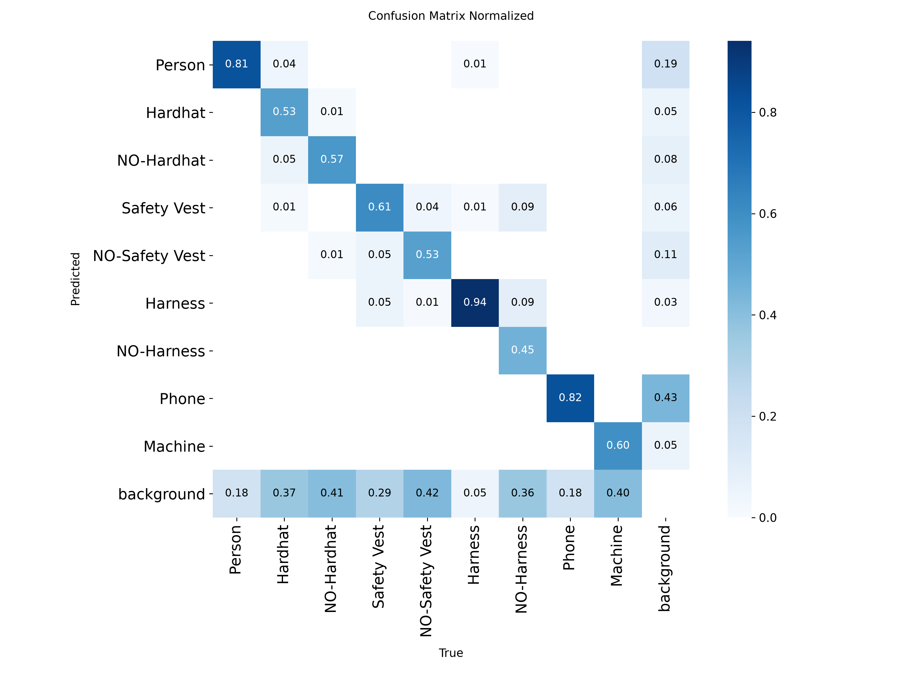

# HSE Vision : détection sécurisée des risques en milieu industriel

Preuve de concept de surveillance vidéo basée sur **YOLOv8**, avec un module de cybersécurité. Le système analyse une vidéo ou une caméra, détecte les personnes, les EPI (casques, gilets, harnais), les téléphones et les engins, puis alerte les responsables HSE.

> **Contexte** : projet de fin d'année (PFA) réalisé chez OCP, année 2025/2026.
>
> **Limite** : c'est une démonstration. Aucun capteur réel ni automate n'est connecté, les mesures de gaz sont simulées, et le système ne doit pas servir d'alarme ou de système de sécurité opérationnel.

## Fonctionnalités

- **Détection et suivi** : YOLOv8s fine-tuné, ByteTrack et lissage des boîtes.
- **Port des EPI** : décision confirmée dans le temps. L'absence de détection d'un casque n'est jamais interprétée comme une absence de casque.
- **Situations dangereuses** : proximité homme-engin, usage du téléphone.
- **Zones dangereuses** : niveau vert, orange ou rouge, à partir de capteurs simulés et de l'état des machines.
- **Cybersécurité** :
  - détection du sabotage caméra (obstruction, déplacement, image dégradée, flux figé, rejeu) ;
  - vérification SHA-256 des poids avant chargement ;
  - journal d'audit signé par HMAC ;
  - contrôle de plausibilité des mesures ;
  - comptes et rôles.
- **Interface web locale** : pages `/live`, `/zones`, `/audit` et `/login`, servies uniquement sur `127.0.0.1`.

## Architecture

```
├── app/
│   ├── detection/      # YOLO EPI + ByteTrack, détecteur de téléphone
│   ├── tracking/       # lissage des boîtes
│   ├── epi/            # association personne-EPI, décision temporelle
│   ├── situations/     # proximité homme-engin
│   ├── zones/          # classement des zones, moniteur, historique, réglages
│   ├── sensors/        # interface SensorProvider, simulateur, plausibilité
│   ├── alerts/         # journal CSV et incidents
│   ├── security/       # sabotage caméra, intégrité des modèles, audit, comptes
│   ├── visualization/  # annotation des images
│   └── live/           # pipeline d'analyse et session temps réel
├── config/             # seuils, profils de caméra, zones de démonstration
├── dashboard/          # serveur web local et pages
├── tools/              # simulateur de sabotage, évaluation, gestion des comptes
│   └── robustness/     # référence, perturbations naturelles, synthèse
├── docs/robustesse/    # graphiques de l'étude de robustesse
├── test_*.py           # tests unitaires
└── run_live.py         # point d'entrée
```

Chaque image passe par le contrôle de sabotage, puis la détection et le suivi, les règles EPI et de proximité, et enfin la gestion des incidents et l'affichage.

## Résultats

Modèle : **YOLOv8s** fine-tuné, 9 classes (Person, Hardhat, NO-Hardhat, Safety Vest, NO-Safety Vest, Harness, NO-Harness, Phone, Machine).

Entraînement : imgsz 640, batch 16, **88 époques** effectuées sur 100 prévues (arrêt anticipé, patience 20), meilleure époque : 68.

| Évaluation | Images | mAP50 |
|---|---|---|
| Validation | 306 | **0,718** |
| Données indépendantes (split test sans quasi-doublons) | 112 | **0,60** |

En validation, la précision est de 0,834, le rappel de 0,631 et la mAP50-95 de 0,455.

**Le chiffre à retenir est 0,60.** La validation est probablement optimiste : 45 % des images du split test sont des quasi-doublons d'images d'entraînement ou de validation, car elles proviennent de vidéos communes. Le rappel des classes casque et gilet reste faible (0,51 à 0,59), et NO-Harness, avec 11 objets en validation, n'est pas évaluable de façon fiable.

**Tests** : le projet complet compte **240 tests**. Cette version publique en contient **232** : les 8 tests retirés portent sur les générateurs d'attaques, non publiés.

### Robustesse

L'étude évalue le modèle face aux dégradations naturelles et à des attaques, selon MITRE ATLAS et OWASP ML01. Les enseignements principaux :

- **Dégradations naturelles** : la poussière, l'occlusion et le flou font perdre des violations sans aucune action d'un attaquant.
- **Attaques optimisées** : elles sont efficaces, mais exigent de connaître les poids. C'est pourquoi ceux-ci ne sont pas diffusés.
- **Prétraitements simples** : ils ne constituent pas une défense suffisante face à un attaquant informé.
- **Conclusion** : la protection repose sur une défense en profondeur (intégrité du flux, confidentialité et intégrité du modèle, détection de sabotage, confirmation temporelle, contrôle humain).



Ces résultats montrent des mécanismes et des ordres de grandeur, obtenus sur un jeu public et peu de vidéos. Ils ne sont pas transposables tels quels à un site réel.

Les générateurs d'attaques, les patchs adverses et les exemples d'attaque ne sont pas publiés.

## Captures

Détection d'une obstruction de l'objectif lors d'une attaque simulée : la caméra passe en « surveillance compromise » et un incident cyber est ouvert.



Matrice de confusion normalisée du modèle :



## Poids du modèle

**Les poids entraînés (`models/best.pt`) ne sont pas publiés, par choix de confidentialité.** L'étude de robustesse montre que les attaques optimisées (perturbations et patchs) reposent sur la connaissance des poids : les diffuser les faciliterait directement. Le contrôle d'intégrité empêche de modifier un modèle, pas de le lire.

Sans poids, le dashboard démarre mais l'analyse vidéo reste indisponible.

### Réentraîner

1. Préparez un jeu de données YOLO aux 9 classes ci-dessus dans `data/datasets/data_ocp/` (`train/`, `valid/`, `test/`, `data.yaml`), en respectant les licences des sources.
2. Lancez l'entraînement avec les paramètres du projet, en adaptant si besoin les chemins de `data.yaml` :

   ```bash
   yolo detect train model=yolov8s.pt data=data/datasets/data_ocp/data.yaml imgsz=640 batch=16 epochs=100 patience=20
   ```

3. Copiez `runs/detect/train/weights/best.pt` vers `models/best.pt`.
4. Téléchargez les poids publics `yolov8n.pt` depuis [Ultralytics](https://github.com/ultralytics/assets/releases), puis enregistrez-les sous `models/yolov8n_coco.pt` (détecteur de téléphone).
5. Enregistrez les empreintes, uniquement pour des poids dont vous avez vérifié la provenance :

   ```bash
   python -m app.security.model_integrity --update
   ```

Vos résultats dépendront de vos données et ne reproduiront pas forcément ceux du tableau.

## Installation

Prérequis : Python 3.10 ou plus récent (testé sous Python 3.14).

```bash
git clone https://github.com/<votre-compte>/hse-vision-securisee.git
cd hse-vision-securisee
python -m venv venv
venv\Scripts\activate            # Windows
# source venv/bin/activate       # Linux / macOS
pip install -r requirements.txt
python tools/manage_users.py create <identifiant> --role admin
```

Aucun compte n'existe par défaut, et le dashboard refuse de démarrer sans administrateur actif. Le mot de passe est saisi de façon masquée.

## Lancement

```bash
python run_live.py
```

Le navigateur s'ouvre sur <http://127.0.0.1:8000/login>. Une fois les poids en place, choisissez une source dans `/live`, puis cliquez sur **Démarrer l'analyse**. Aucune vidéo n'est fournie : déposez les vôtres dans `data/test_videos/` ou ajoutez-les depuis l'interface.

Pour lancer les tests, qui ne nécessitent ni poids ni données :

```bash
python -m unittest discover
```

## Jeu de données

Jeux de données publics issus de Roboflow Universe, fusionnés et harmonisés en 9 classes ; liste des sources et licences en cours de vérification. Les images ne sont pas redistribuées dans ce dépôt.

Répartition : 1 864 images d'entraînement, 306 de validation et 204 de test.

## Contenu non publié

Ne figurent pas dans ce dépôt : les vidéos et sorties d'analyse, les journaux d'audit, les comptes et clés, les poids entraînés, les patchs et générateurs d'attaques, ainsi que les images et documents internes du site.

## Auteure

**Sabrine Ouarchane**, élève ingénieure en IA et cybersécurité, ENSA Béni Mellal.
